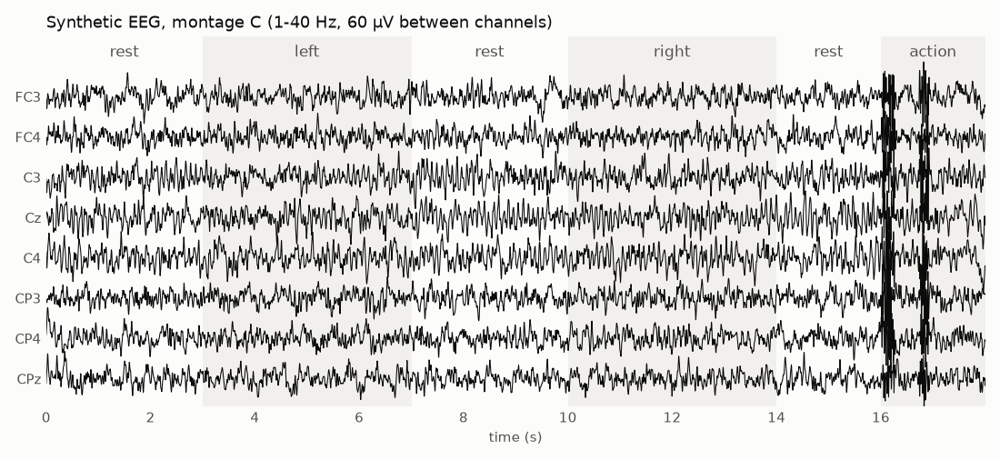
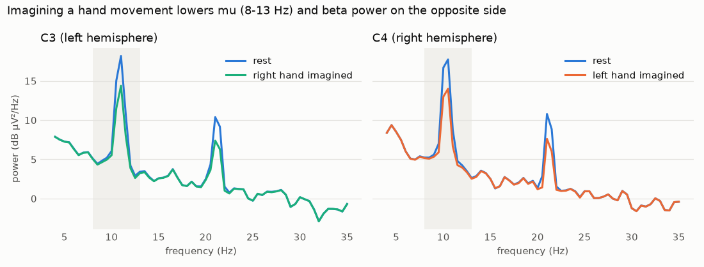

<p align="center">
  
</p>

<h1 align="center">OpenMind Plug</h1>

<p align="center">
  <b>The universal EEG plug.</b><br>
  Any EEG source in, one standard Lab Streaming Layer stream out.
</p>

<p align="center">
  <a href="https://github.com/openmind-bci/plug/actions/workflows/ci.yml"></a>
  <a href="LICENSE"></a>
  
  
</p>

> [!WARNING]
> **Research and experimentation project — not a medical device.**
> OpenMind Plug must not be used for diagnosis, treatment or any clinical decision.

Plug reads an EEG source (a real headset, a recorded file, a public dataset or a
synthetic signal) and publishes it as a **standard
[Lab Streaming Layer](https://labstreaminglayer.org) (LSL) stream**: microvolts,
10-20 channel labels, units, montage and acquisition details, plus a JSON
markers stream. Whatever produces the signal, consumers always see the same
stream, described in the [stream specification](docs/stream-spec.md).

<picture>
  <source media="(prefers-color-scheme: dark)" srcset="docs/media/synthetic-eeg-dark.png">
  
</picture>

*The synthetic source, driven from the keyboard: motor imagery changes the
rhythms over the motor cortex, and a double jaw clench (the `action` gesture)
shows up as a strong muscle burst on every electrode.*

## Part of OpenMind BCI

```
 ┌──────────────────────────┐     ┌────────────────────────┐     ┌──────────────────────┐
 │  plug  (this repo)       │     │  core                  │     │  sandbox             │
 │  any EEG source          │────▶│  intent decoding       │────▶│  virtual and real    │
 │  → standard LSL stream   │ LSL │  → OpenMind commands   │MQTT │  objects             │
 └──────────────────────────┘     └────────────────────────┘     └──────────────────────┘
```

| Repository | Role |
|---|---|
| **plug** (this one) | EEG source → standard LSL stream |
| [core](https://github.com/openmind-bci/core) | LSL stream → user intent → MQTT commands |
| [sandbox](https://github.com/openmind-bci/sandbox) | Virtual and real objects driven by those commands |

Plug does no AI and no decoding: it is useful to anyone who needs a clean,
well-described EEG stream, inside or outside OpenMind.

## Sources

| Source | What it does | Status |
|---|---|---|
| `synthetic` | Realistic generator: 1/f background, alpha, mu and beta rhythms with controllable desynchronization, blinks, muscle, jaw clenches, mains noise. Seeded, so the same seed gives the same signal. | available |
| `replay` | Public datasets (MOABB) and recorded files, in real time | available |
| `lsl` | Relay of a third-party LSL stream, rewritten in standard form | available |
| `brainflow` | Any board supported by BrainFlow | planned |
| `ironbci` | IronBCI-8 headset over BLE | planned (experimental) |

The synthetic source is close enough to real EEG to develop and test the whole
chain without a headset: imagining a hand movement lowers the mu and beta
rhythms over the opposite hemisphere, as it does in real recordings.

<picture>
  <source media="(prefers-color-scheme: dark)" srcset="docs/media/synthetic-spectra-dark.png">
  
</picture>

Three montages are built in (`A`, `B`, `C`); montage `C` holds the eight motor
electrodes used by OpenMind Core (`FC3, FC4, C3, Cz, C4, CP3, CP4, CPz`).
See [Sources](docs/sources.md) for every option.

## Installation

Requires Python 3.11+.

```bash
pip install openmind-plug                      # core
pip install "openmind-plug[replay]"            # + public dataset replay (MOABB)
pip install "openmind-plug[brainflow,ironbci]" # + hardware drivers
```

From source, with [uv](https://docs.astral.sh/uv/):

```bash
git clone https://github.com/openmind-bci/plug.git
cd plug
uv sync
uv run openmind-plug --help
```

## Quick start without a headset

Stream the synthetic source, controlled from the keyboard
(`a` left, `d` right, `s` feet, `r` rest, `e` eyes, `b` blink, `j` jaw clench, `q` quit):

```bash
openmind-plug stream --source synthetic --montage C
```

Or replay a public dataset in real time (needs the `replay` extra):

```bash
openmind-plug stream --source replay --dataset bnci2014_001 --subject 1
```

In another terminal, check the stream against the specification:

```bash
openmind-plug check-stream
```

Any LSL consumer (OpenMind Core, [LabRecorder](https://github.com/labstreaminglayer/App-LabRecorder),
MNE-LSL...) can then pick up the `openmind-eeg` stream. A step-by-step guide is in
[Getting started without a headset](docs/getting-started.md).

| Command | Purpose |
|---|---|
| `openmind-plug list-sources` | List sources and whether they can be used |
| `openmind-plug stream --source …` | Publish a source as the standard LSL streams |
| `openmind-plug check-stream` | Check a live stream against the specification |
| `openmind-plug record --subject P01` | Record the stream to a FIF file ([details](docs/recording.md)) |
| `openmind-plug quality [--alpha-test]` | Check signal quality per channel ([details](docs/quality.md)) |

Run any command with `--help` for its options. Ready-to-run scripts are in
[`examples/`](examples/).

## Reading the stream from Python

```python
from openmind_plug.inlet import EEGInlet

with EEGInlet() as inlet:  # finds the openmind-eeg stream
    print(inlet.info.channels)  # labels, units, positions
    samples, timestamps = inlet.read(timeout=1.0)  # (n_samples, n_channels), µV
    markers = inlet.read_markers()  # from every openmind-markers stream
```

## The stream in one glance

| Stream | Type | Content |
|---|---|---|
| `openmind-eeg` | `EEG`, float32 | microvolts, nominal rate of the source (250 Hz for IronBCI-8), channel labels, units and positions, acquisition details, `spec_version` |
| `openmind-markers` | `Markers`, string | JSON events (`cue`, `state`, `eyes`, `artifact`...), time-stamped on the EEG sample they refer to |

The full contract, versioned with SemVer, is in [docs/stream-spec.md](docs/stream-spec.md).

## Documentation

| Guide | Content |
|---|---|
| [Getting started](docs/getting-started.md) | Stream, check and record without a headset |
| [Sources](docs/sources.md) | Every source and its options |
| [Stream specification](docs/stream-spec.md) | The LSL contract consumed by core and sandbox |
| [Recording](docs/recording.md) | Record a session to FIF |
| [Signal quality](docs/quality.md) | Per-channel checks and the alpha test |
| [Adding a driver](docs/adding-a-driver.md) | Support a new headset |

## Data and privacy

EEG recordings are health data. Plug processes everything **locally**, never sends
data to a remote service, and stores downloads and recordings outside the
repository, in the directory given by `OPENMIND_DATA_DIR` (default: `~/openmind-data`).
Subjects are identified only by pseudonyms (`P01`, `P02`...).

## Contributing

See [CONTRIBUTING.md](CONTRIBUTING.md) and [CHANGELOG.md](CHANGELOG.md).

## License

[Apache-2.0](LICENSE).
